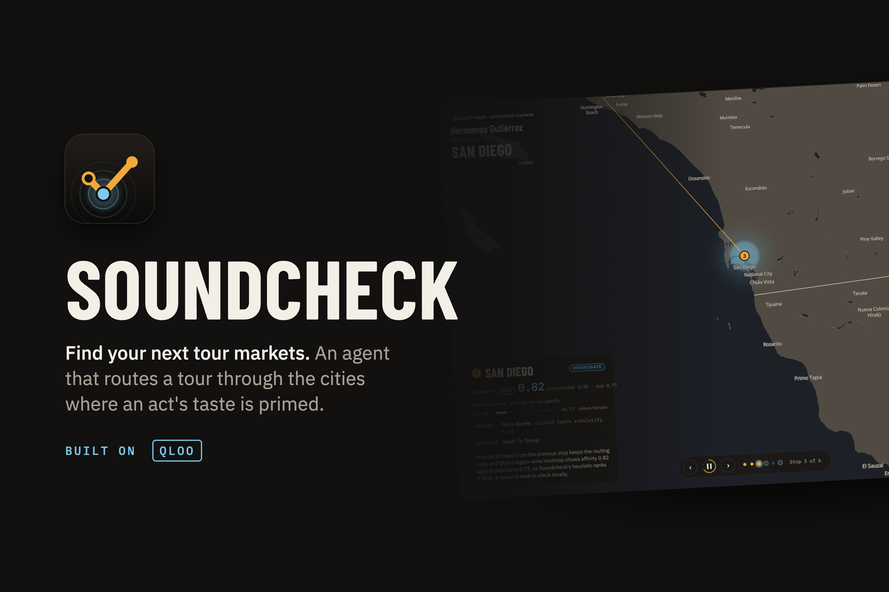
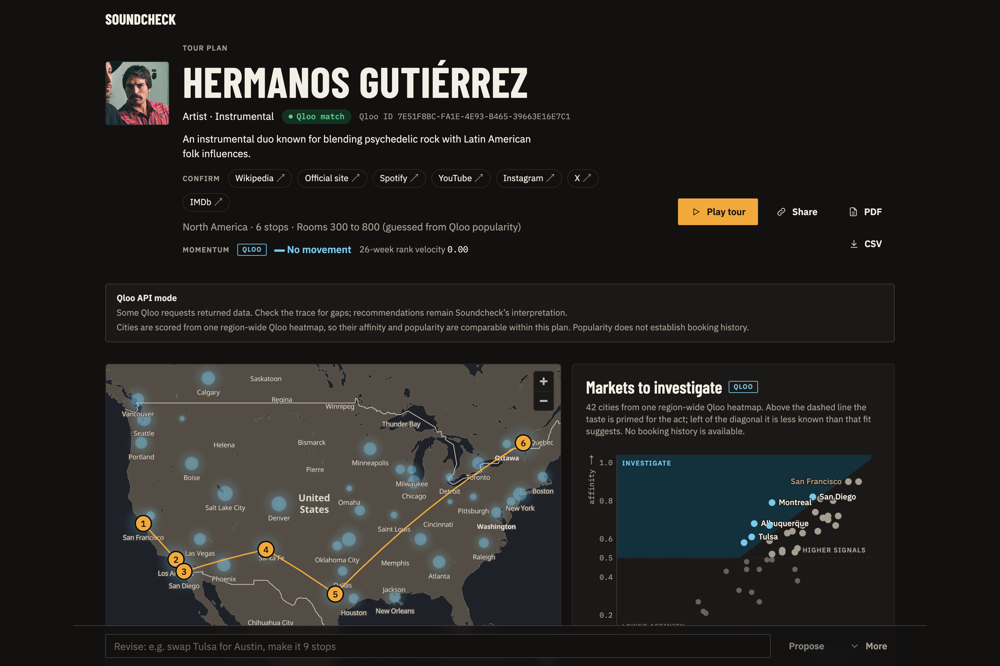
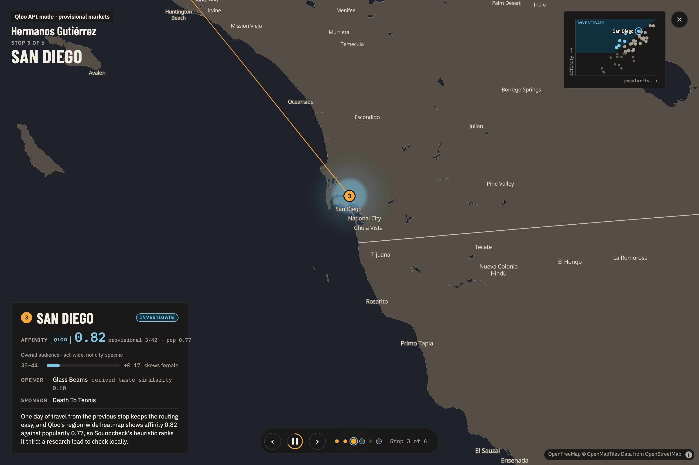
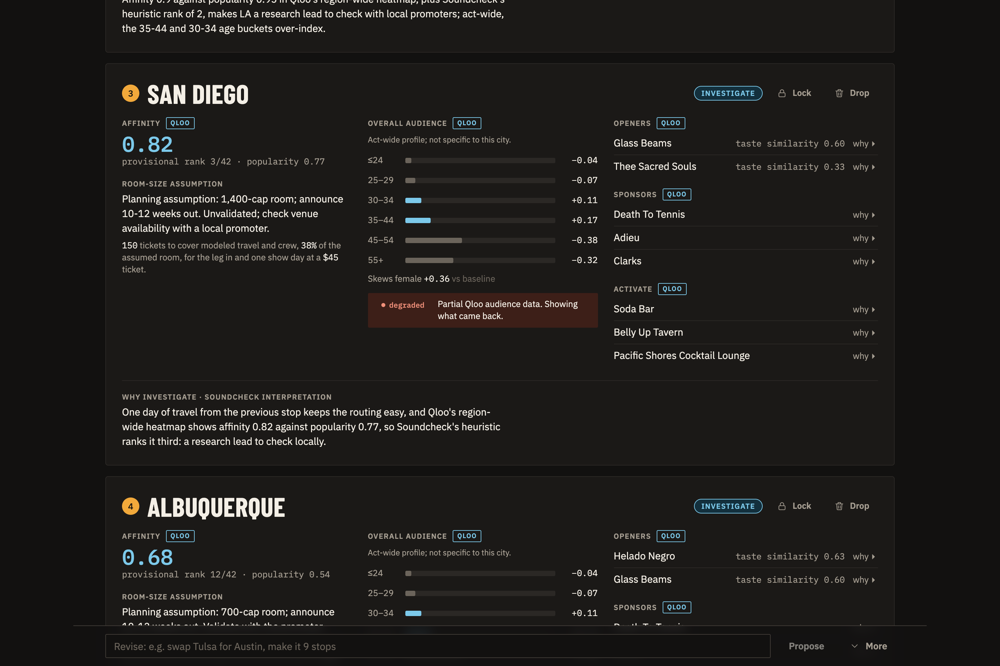
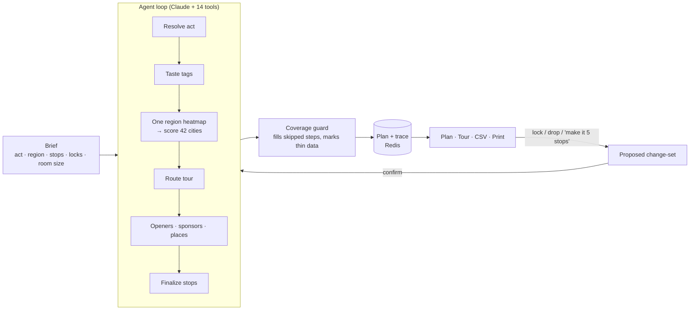

<div align="center">


# Soundcheck

**Tour research for independent artist managers, grounded in cultural taste.**

An AI agent that turns an act and a touring brief into candidate cities, a route, possible support acts, sponsors and local activations. Every recommendation is traced back to the Qloo calls behind it.

[](https://soundcheck-amber-two.vercel.app)
[](https://soundcheck-amber-two.vercel.app/plan/5kpsJZ9UKG)




[Try it](#-try-it-in-five-minutes) · [Watch the agent](#-watch-the-agent-work) · [Judges' checklist](#-judges-validation-checklist) · [How it works](#-how-it-works) · [Run locally](#-run-locally) · [Limitations](#-limitations-stated-up-front)

</div>

---

## 🎯 The problem

Before contacting a single venue, an independent artist manager has to work out which cities are worth investigating, in what order, with which opener, and which local brands or venues might fit. That research is usually scattered across streaming stats, instinct and spreadsheets.

Soundcheck runs it as an agent. It resolves the act in Qloo, reads its taste profile, scores every city in a region from **one region-wide heatmap**, routes a tour, looks for openers **less famous than the headliner**, and finds sponsor and venue candidates. The manager can then lock, drop or reorder stops, ask for changes in plain English, and export a planning brief.

| Plan overview | Tour mode | City evidence card |
| :---: | :---: | :---: |
|  |  |  |

---

## 🚀 Try it in five minutes

You don't need to sign in or install anything. Everything below runs on the public deployment.

| # | Do this | What you should see |
|:-:|---|---|
| 1 | Open the **[live Qloo plan](https://soundcheck-amber-two.vercel.app/plan/5kpsJZ9UKG)** (Hermanos Gutiérrez, North America, 6 stops) | A source banner saying the plan used **live Qloo data** with a **region-normalized** heatmap. Route: San Francisco → Los Angeles → San Diego → Albuquerque → Austin → Montreal. |
| 2 | Read the **Markets to investigate** quadrant | 42 candidate cities plotted by affinity against popularity. *Untapped* cities have strong taste alignment but lower awareness of the act. Three of the six stops are untapped. |
| 3 | Click a stop, for example **San Diego** | The city card shows affinity and popularity, the act-wide audience, openers with their derived taste similarity, sponsors, venues and activations, and the agent's reasoning. |
| 4 | Scroll to the **agent trace** at the bottom | Every step the agent took (resolve, taste, score, momentum, profile, route, places, openers, sponsors, guard, explain), each with a status and its redacted Qloo requests. |
| 5 | Click **Drop** on a stop, or type *"drop Montreal and make it 5 stops"* in the revise bar | A proposed change-set to review. Applying it runs a **new** plan; the original keeps its URL. |
| 6 | Open **[Tour mode](https://soundcheck-amber-two.vercel.app/plan/5kpsJZ9UKG/tour)** | An animated route across the map, one stop per beat. <kbd>Space</kbd> pauses, <kbd>←</kbd> <kbd>→</kbd> move between stops, <kbd>Esc</kbd> returns to the plan. |
| 7 | Export as **[CSV](https://soundcheck-amber-two.vercel.app/api/plan/5kpsJZ9UKG/csv)** or **[Print / PDF](https://soundcheck-amber-two.vercel.app/plan/5kpsJZ9UKG/print)** | A planning brief with the same data-source labels as the interactive plan. |
| 8 | On the **[home page](https://soundcheck-amber-two.vercel.app)**, plan your own act | A live run streams in: trace steps tick over, candidate cities appear, then stops fill in. It takes about a minute. |

> [!TIP]
> For step 8, pick an act with a North American following (for example *Khruangbin*, *Black Pumas* or *Mdou Moctar*), 6 stops and a stated room size. Custom runs are rate limited to 2 at a time and 20 per 15 minutes to protect the API budget. If you see "try again shortly", wait a minute.

> [!NOTE]
> The three example cards on the home page (musician, comedian, podcast) are **synthetic** workflow demos. They were generated before the Qloo key arrived, and their banner says so. The Hermanos Gutiérrez plan, and every plan you create, runs against the **live** Qloo API.

---

## 🔍 Watch the agent work

The agent is Claude (`claude-sonnet-5-5`, through the Vercel AI SDK) calling **14 typed tools**, most of which wrap a Qloo endpoint. When the model finishes, a deterministic **coverage guard** fills any step it skipped with exactly the same code, so a plan can't silently miss data. If no model key is configured, the guard runs the whole plan and the trace marks the model step as degraded.

### The tools the model can call

| Tool | Qloo endpoint | Purpose |
|---|---|---|
| `searchAct`, `confirmAct` | `GET /search` | Resolve the act to a Qloo entity, with a disambiguation hint |
| `getTasteTags` | `GET /v2/insights?filter.type=urn:tag` | The act's taste profile |
| `findTags` | `GET /v2/tags` | Seed tags for the thin-data fallback and for venue searches |
| `probeCities` | `GET /v2/insights?filter.type=urn:heatmap&filter.location=POLYGON(…)` | **One** region-wide heatmap, so every city shares one scale |
| `scoreCities` | (local) | Affinity, popularity, underserved score and quadrant per city |
| `getMomentum` | `GET /v2/trending` | 26-week momentum series |
| `getDemographics` | `GET /v2/insights?filter.type=urn:demographics` | Act-wide audience profile |
| `routeTour` | (local) | Route that honours locks, drops and a manual order |
| `findOpeners` | `GET /v2/insights?filter.type=urn:entity:artist&filter.popularity.max=…` | Related acts in a popularity band below the headliner |
| `compareAudiences` | `GET /v2/analysis/compare` | Shared taste tags, turned into a derived similarity |
| `findSponsors` | `GET /v2/insights?filter.type=urn:entity:brand` | Brand candidates seeded by the act and its audience |
| `findPlaces` | `GET /v2/insights?filter.type=urn:entity:place` | Venues and local activations per city |
| `finalizeStop` | (local) | Commit a stop with the model's written reasoning |

Code: [`src/lib/agent/tools.ts`](src/lib/agent/tools.ts) (tools and tracer), [`src/lib/agent/run.ts`](src/lib/agent/run.ts) (loop, guard and copy), [`src/lib/qloo/live.ts`](src/lib/qloo/live.ts) (HTTP client), [`src/lib/agent/prompts.ts`](src/lib/agent/prompts.ts) (instructions).

### Three ways to see the calls

**1. In the UI.** Every plan page ends with the agent trace. Expand a step to see each Qloo request (keys and entity IDs redacted), its status (`ok`, `partial`, `degraded`, `empty` or `error`), its latency and whether it was served from cache.

**2. From the saved plan JSON.** This lists every step with its first request:

```sh
curl -s https://soundcheck-amber-two.vercel.app/api/plan/5kpsJZ9UKG | jq '
  {provenance, summary,
   trace: [.trace[] | {id, status, calls: (.calls | length), first: .calls[0].request}]}'
```

What to look for in the output:

```jsonc
"provenance": { "dataMode": "live", "heatmapComparability": "region-normalized", ... },
"summary": {
  "qlooCallTypes": 10, "qlooCalls": 35, "untappedStops": 3,
  "model": { "id": "claude-sonnet-5-5", "calls": 7, "steps": 14, "promptCache": true, ... }
},
"trace": [
  { "id": "resolve", "status": "ok", "calls": 1,  "first": "GET /search?query=[act]&types=urn:entity:artist&take=5" },
  { "id": "score",   "status": "ok", "calls": 1,  "first": "GET /v2/insights?filter.type=urn:heatmap&filter.location=POLYGON((-125%2028,...))" },
  { "id": "openers", "status": "ok", "calls": 14, ... },
  ...
]
```

**3. Stream a fresh run.** `POST /api/plan` streams newline-delimited JSON events (`provenance`, `step`, `act`, `candidates`, `momentum`, `stop`, then `done`). This prints each event as it arrives:

```sh
curl -sN https://soundcheck-amber-two.vercel.app/api/plan \
  -H 'content-type: application/json' \
  -d '{"actQuery":"Khruangbin","region":"north-america","stops":6,"roomTier":"800to2000"}' \
| jq -c 'if   .type=="step" then {step: .step.id, status: .step.status, calls: (.step.calls | length)}
         elif .type=="stop" then {stop: .stop.order, city: .stop.city.name}
         elif .type=="done" then {done: .plan.id, summary: .plan.summary}
         else {event: .type} end'
```

Open `https://soundcheck-amber-two.vercel.app/plan/<id from the done line>` to see the same run in the UI.

<details>
<summary><b>Request fields</b></summary>

| Field | Type | Default |
|---|---|---|
| `actQuery` | string, required | |
| `actType` | `artist` · `person` · `podcast` · `book` · `video_game` · `brand` | `artist` |
| `region` | `north-america` · `uk-ireland` · `europe` | `north-america` |
| `stops` | integer 3 to 20 | `10` |
| `window` | free text, e.g. `"Jan–Mar 2027"` | |
| `lockedCities`, `excludedCities` | city ids, e.g. `["austin"]` | `[]` |
| `budgetTier` | `van` · `bus` · `production` | `bus` |
| `roomTier` | `under300` · `300to800` · `800to2000` · `2000to5000` · `over5000` | guessed and labeled as a guess |

To revise, send `{"parentId": "<plan id>", "changes": {"drop": ["montreal"], "stops": 5}}`. Schemas live in [`src/lib/types.ts`](src/lib/types.ts).

</details>

---

## ✅ Judges' validation checklist

Each check is quick and has a concrete expected result.

### Platform

- [ ] **Health.** `curl -s https://soundcheck-amber-two.vercel.app/api/health` returns
  `{"ok":true, "seeded":{...all true}, "kv":{"kind":"redis","status":"ok"}, "qloo":"live", "model":true}`.
  `qloo: "live"` means real Qloo calls; `model: true` means Claude drives the tools.
- [ ] **Input validation.** Send a bad body and expect HTTP 400 with per-field issues and no run started:
  ```sh
  curl -s -X POST https://soundcheck-amber-two.vercel.app/api/plan -H 'content-type: application/json' -d '{"stops":2}'
  # {"error":"Invalid plan input","issues":[{"path":"actQuery",...},{"path":"stops","message":"Too small: expected number to be >=3"}]}
  ```

### The agent and Qloo

- [ ] **Real tool calls.** In the live plan's trace (UI or JSON above), `resolve`, `taste`, `score`, `momentum`, `openers`, `sponsors` and `places` each list Qloo requests; `summary.qlooCalls` is 35 over 10 call types.
- [ ] **One shared scale.** The `score` step has exactly **one** heatmap call with a `POLYGON` filter covering all 42 cities. Per-city heatmaps are normalized within each query and can't be compared, which we found on key day (see [`docs/VALIDATION.md`](docs/VALIDATION.md)).
- [ ] **Openers below the headliner.** On a plan you create yourself, each city card shows the openers' popularity, which sits below the act's, and the `openers` requests include `filter.popularity.max`. (The featured Hermanos Gutiérrez plan was made before this band was added, so its openers don't show popularity.)
- [ ] **Honest degradation.** The `profile` step shows `degraded`, because Qloo demographics are act-wide and not per city, and the UI says so rather than inventing city audiences.
- [ ] **Model accounting.** `summary.model` reports calls, steps and token usage, including prompt-cache reads.
- [ ] **A fresh run of your own** (UI step 8 or the `curl -sN` command) ends with a `done` event, and the new plan's banner says live data.

### Revisions

- [ ] **Natural-language proposal.** This uses one model call and changes nothing:
  ```sh
  curl -s -X POST https://soundcheck-amber-two.vercel.app/api/plan/5kpsJZ9UKG/propose \
    -H 'content-type: application/json' -d '{"request":"drop Montreal, lock Austin, make it 5 stops"}'
  # {"changes":{"drop":["montreal"],"lock":["austin"],"stops":5,...},"note":"...","unmatched":[]}
  ```
- [ ] **Originals are preserved.** Apply a revision in the UI. The new plan links to its parent, and `/plan/5kpsJZ9UKG` is unchanged.

### Output and provenance

- [ ] CSV, print view, tour and plan page all carry the same data-source label: **live** on the Hermanos Gutiérrez plan, **synthetic** on the home-page examples.
- [ ] At 390 px wide (phone), the plan page scrolls vertically with no horizontal overflow.

---

## 🧠 How it works



| Planning question | Qloo workflow | How Soundcheck reads it |
| --- | --- | --- |
| Which act? | Entity search | Resolve identity; ambiguity can need external confirmation. |
| What tastes? | Taste tags and tag search | Interpretation, and a tag-seeded fallback when direct data is thin. |
| Which markets? | Geographic heatmap | One region-wide heatmap per plan, so city affinity and popularity share a scale. Not ticket demand, booking history or venue availability. |
| Which audience? | Demographics and trending | Act-wide audience and momentum, not city-specific demand. |
| Which support acts? | Related entities and compare | Derived taste similarity within a popularity band, not shared-fan percentage. |
| Which partners? | Brand and place insights | Cultural-fit candidates, not confirmed interest or availability. |

**Scoring.** Heatmap cells within 40 km of each city are assigned to it, and the city value is the top-10 mean. A city is *untapped* when affinity ≥ 0.5 and affinity exceeds popularity by at least 0.02, *established* at affinity ≥ 0.5 otherwise, and *reach* below 0.5 ([`src/lib/score.ts`](src/lib/score.ts)). Routing, market labels, room sizes and travel economics are Soundcheck's own interpretations and are labeled as such.

**Stack.** Next.js 16 (App Router) on Vercel · Vercel AI SDK 7 with Anthropic · Qloo Insights API · Redis on Railway for plans and the Qloo cache · MapLibre with OpenFreeMap tiles · Tailwind v4 · Vitest.

---

## 💻 Run locally

Requires Node 22+ and pnpm (the pinned version is in `package.json`).

```sh
pnpm install
cp .env.example .env.local   # synthetic Qloo data, no model key needed
pnpm dev                     # http://localhost:3000
```

| Mode | Set in `.env.local` | Result |
|---|---|---|
| Fully offline | `QLOO_MOCK=1`, no `ANTHROPIC_API_KEY` | Deterministic orchestrator on synthetic Qloo fixtures; the model step is marked degraded. No cost. |
| Agent on mock data | `QLOO_MOCK=1`, `ANTHROPIC_API_KEY=…` | Claude drives the tools against fixtures. Uses model credits. |
| Fully live | `QLOO_MOCK=0`, `QLOO_API_KEY=…`, `ANTHROPIC_API_KEY=…` | What production runs. |

Useful local checks:

```sh
curl -s localhost:3000/api/health          # confirm the mode before running anything
open http://localhost:3000/run?demo=1      # replays a saved run's stream (a fixture, not a new agent run)
QLOO_MOCK=1 ANTHROPIC_API_KEY= pnpm seed   # pre-generate the three examples at no model cost
```

`pnpm seed demo-musician` replaces that example; keep a copy first if you need it. Old saved examples don't become live on their own.

**Quality gates**

```sh
pnpm test        # Vitest on synthetic data
pnpm typecheck
pnpm lint
pnpm build
```

<details>
<summary><b>Optional matched-brief comparison</b></summary>

`SOUNDCHECK_WITHOUT_QLOO=1` adds one model call to new plans: the same brief and city constraints, without Qloo tools. Invalid results are omitted. This is an illustrative comparison, not a controlled benchmark, because tool access, call count and inference budget differ. See the [evaluation protocol](docs/VALIDATION.md) before claiming better outcomes.

</details>

<details>
<summary><b>Deploying</b></summary>

The web app runs on Vercel while the agent API and Redis run on Railway. Set `SOUNDCHECK_BACKEND_URL` to the Railway HTTPS origin on Vercel only; API requests are forwarded there and server-rendered pages read the same saved plans. Leave it unset on Railway to avoid a proxy loop. The Vercel project needs no model keys and no public database access.

- **Vercel:** `vercel.json` selects Next.js. Set `ENABLE_EXPERIMENTAL_COREPACK=1` so installs follow the pinned `packageManager`, then `pnpm dlx vercel --prod`.
- **Railway:** `railway up --service soundcheck --ci`, with `REDIS_URL=${{Redis.REDIS_URL}}`, `QLOO_API_KEY`, `QLOO_MOCK` and `ANTHROPIC_API_KEY`. Without Redis, development uses memory and `.cache/plans`.
- Deploy Railway before Vercel when API behaviour changes.
- Run limits are per instance: `SOUNDCHECK_PLAN_CONCURRENCY` (default 2) and `SOUNDCHECK_PLAN_STARTS` (default 20 per 15 minutes). Over the limit the API returns 429 with `Retry-After`; saved plans stay readable. Limits reset on restart and are not a distributed quota or spending cap.

</details>

---

## ⚠️ Limitations, stated up front

- **Affinity isn't ticket demand.** It doesn't reflect booking history or venue availability. Market labels and thresholds are exploratory heuristics.
- **Demographics and momentum are act-wide.** Qloo ignores location on these calls, so Soundcheck doesn't present them as city audiences.
- **Similarity isn't shared fans.** Opener similarity is derived from shared taste tags.
- **Economics are partial.** Room sizes and announcement timing are assumptions. Tickets-to-cover reflects modeled travel and crew costs, not full break-even; venue hire, act fees, hotels and flights aren't fully priced.
- **Routing is approximate.** It uses curated city pools and geographic distances. Budget tier changes cost assumptions, not optimization constraints, and the date window is context, not a checked schedule.
- **The home-page examples are synthetic.** Comedian and podcast live coverage hasn't been verified.
- **No outcome claims.** No measured ticket-sales uplift, customer adoption or recommendation-quality advantage is claimed. User evaluation hasn't been run yet.

---

## 📚 Docs

| File | What it is |
|---|---|
| [`docs/VALIDATION.md`](docs/VALIDATION.md) | Key-day live-data findings, user-evaluation and comparison protocols |
| [`docs/DEMO.md`](docs/DEMO.md) | Two-minute walkthrough and submission draft |
| [`docs/STATUS.md`](docs/STATUS.md) | Build log by session, including live run measurements |
| [`docs/UX.md`](docs/UX.md) | Screens, layouts and visual direction |
| [`docs/STACK.md`](docs/STACK.md) | Engineering stack choices and rationale |
| [`docs/RESEARCH.md`](docs/RESEARCH.md) | Hackathon rules, Qloo API mapping and judging notes |
| [`docs/design/`](docs/design/README.md) | Icon and gallery images |

---

<div align="center">

Built for the [Qloo Agentic Hackathon](https://qloo.devpost.com/) · MIT licensed, see [`LICENSE`](LICENSE)

</div>
